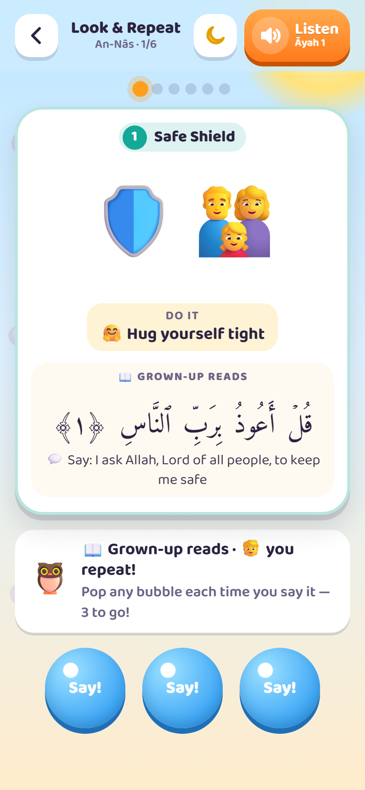
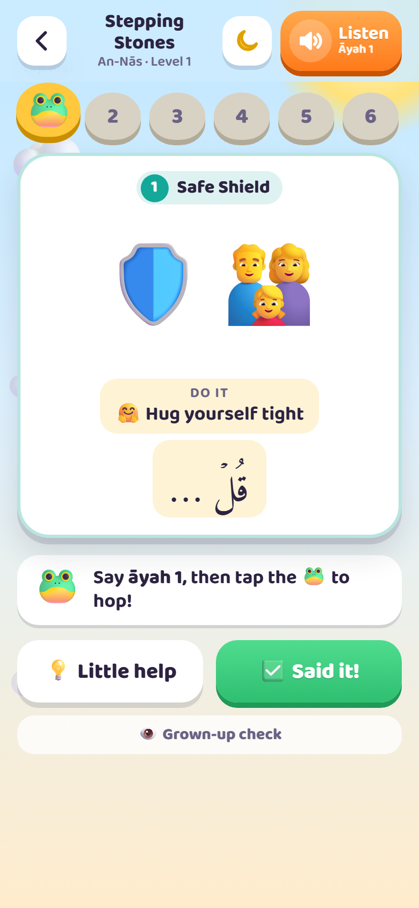

# Little Hafiz Quest

A fun, picture-and-gesture game that helps young children (around age 4–7) **memorize Juz ‘Amma**, sūrahs 78 to 114, by heart.

A grown-up who reads Arabic recites each āyah; the child listens, repeats and does a hand action. Every āyah has its own picture and movement, so the picture brings back the words. Step by step, the clues fade until the child recites with no help at all.

**Play it:** https://akstudios.github.io/little-hafiz-quest/

Free, no ads, no accounts, no tracking. It works on iPhone, iPad, Android, and computers, and keeps working without internet once it's been opened.

<table>
  <tr>
    <td align="center"></td>
    <td align="center"></td>
    <td align="center"></td>
    <td align="center"></td>
  </tr>
  <tr>
    <td align="center">Island map</td>
    <td align="center">Sūrah island</td>
    <td align="center">👀 Look &amp; Repeat</td>
    <td align="center">🐸 Stepping Stones</td>
  </tr>
</table>

> [!IMPORTANT]
> This is a free helper for parents, not an authority on the Qur'an. The text and recitation come from public sources and are **not guaranteed to be free of mistakes**. Please check each āyah against a trusted muṣḥaf or teacher before teaching it. See the [Disclaimer](#disclaimer).

---

## How to play (for the grown-up)

1. **Pick an island.** Start at 🚩 An-Nās and work up the map. Longer sūrahs are split into checkpoints of a few āyāt.
2. **👀 Look & Repeat.** Read the āyah. Your child repeats it three times while doing the action (pop a bubble each time), then says it with only the picture showing. After each new āyah, chain from the first āyah up to the new one.
3. **Word Steps.** For long āyāt: build the āyah one word at a time, always going back to the first word. Then your child says it all while you reveal each word.
4. **🐸 Stepping Stones.** Your child says each āyah and taps the frog to hop. Level 1 shows the picture and first word, Level 2 only the picture, and Level 3 no picture at all. Level 3 means it's memorized.
5. **Review** with 🧩 Picture Puzzle (drag pictures into order), 🔮 What Comes Next, and the 🎁 Mystery Box.

Five to ten minutes a day is plenty. Stop while it's still fun.

The orange **Listen** button at the top plays the recitation of what's on screen. Settings (⚙️, the Grown-up Corner) let you choose a dim night theme, show simple meanings or transliteration, repeat or slow down the recitation, and reset stars.

## Put it on a phone like an app

**iPhone or iPad**
1. Open the link in **Safari**.
2. Tap **Share** → **Add to Home Screen**.
3. Open the game from the new Home Screen icon from now on. On iPhone, the Home Screen app keeps its own stars, separate from Safari.
4. For full offline use, go to ⚙️ Grown-up Corner → Offline → **Save all recitations** (21 MB, once).

**Android**
1. Open the link in **Chrome**.
2. Tap **⋮** → **Add to Home screen** (or **Install app**).
3. For full offline use: ⚙️ → Offline → **Save all recitations**.

**Computer**: just open the link. Chrome and Edge also offer an "Install" button in the address bar.

> Opening the `index.html` file straight from Files, WhatsApp or email on an iPhone shows a preview that can't run games. Always share the **link**.

## Privacy

- No accounts, analytics, ads or trackers.
- The game never contacts any other website. Every file it uses is in this repository.
- Stars and settings are stored only on the device (browser cookies and storage). Nothing is uploaded.

## Browser support

Safari on iOS and iPadOS 15 or later, Chrome, Edge, Firefox and Samsung Internet, on phones, tablets and computers.

---

## For developers

No build step and no dependencies: plain HTML, CSS and JavaScript.

```
index.html             page shell, security policy, Home Screen metadata
css/game.css           styles (light and dim themes, animations)
js/data.js             all content: Arabic text, memory cues, checkpoints, audio timings
js/game.js             game logic
sw.js                  service worker: offline support
manifest.webmanifest   Home Screen app details
audio/NNN.mp3          recitation, one file per sūrah (plus 001.mp3 for the Basmalah)
fonts/                 Amiri Quran and Baloo 2, with their licences
icons/                 app icons
tools/serve.py         local preview server
screenshots/           README pictures (not used by the game)
```

**Preview locally**

```
python3 tools/serve.py
```

Then open http://localhost:8000/. Use this rather than `python3 -m http.server`, because the audio player needs "Range" requests to jump to each āyah.

**Change a picture, action or meaning:** edit that āyah's line in `js/data.js`. Each āyah has `scene` (1–3 emoji), `hook`, `gesture`, `kid` (simple meaning) and `anim`. Keep scenes different within a sūrah.

**After any change:** bump `VERSION` in `sw.js` (and in `js/game.js`, which is shown in settings). Installed copies then pick up the new version on their next visit.

**Deploy:** GitHub Pages serves the `main` branch root. Pushing to `main` publishes the change within a minute or two.

## Disclaimer

Little Hafiz Quest is a free tool, made only to help parents and other grown-ups teach young children. It is provided **"as is", without any warranty**.

- **No guarantee of correctness.** The Arabic text, recitation audio, āyah timings, simple meanings and transliterations come from public sources and were put together with care, but their accuracy and completeness are not guaranteed.
- **You are responsible for checking.** The grown-up using the game is responsible for making sure every āyah and recitation is correct before teaching it, by checking against a trusted muṣḥaf or a qualified teacher.
- **Not a replacement for a teacher.** The simple meanings are written for young children and are not a translation or tafsīr. The game supports, but does not replace, learning with a qualified Qur'an teacher.
- **No liability.** The author accepts no responsibility or liability for errors in the content, for anything a child learns incorrectly, or for any problem, loss or harm arising from using this game. Use it at your own risk.

See also the warranty and liability terms in [LICENSE](LICENSE).

## Credits and licences

- **Code** (`index.html`, `css/`, `js/game.js`, `sw.js`, `tools/`, `manifest.webmanifest`, `icons/`): MIT, see [LICENSE](LICENSE).
- **Qur'an text** in `js/data.js`: from [quran-json](https://github.com/risan/quran-json) by Risan Bagja Pradana (Uthmani text from [The Noble Qur'an Encyclopedia](https://quranenc.com)), licensed [CC BY-SA 4.0](https://creativecommons.org/licenses/by-sa/4.0/). `js/data.js` adapts it (open tanwīn marks converted to standard Unicode, memory cues added) and is shared under CC BY-SA 4.0 as well.
- **Memory cues, simple meanings and transliterations** in `js/data.js`: written for this project, CC BY-SA 4.0. The simple meanings are written for young children and are not a translation; see a full tafsīr for detail.
- **Recitation** in `audio/`: Sheikh Mishary Rashid Alafasy, from [EveryAyah.com](https://everyayah.com), joined into one file per sūrah. Included for free, non-commercial educational use; all rights to the recordings remain with their owners.
- **Fonts**: [Amiri Quran](https://github.com/aliftype/amiri) by Khaled Hosny and [Baloo 2](https://github.com/EkType/Baloo2) by Ek Type, both under the SIL Open Font License 1.1 (see `fonts/`).
- **Pictures** are the device's own emoji, so they look slightly different on each phone.
