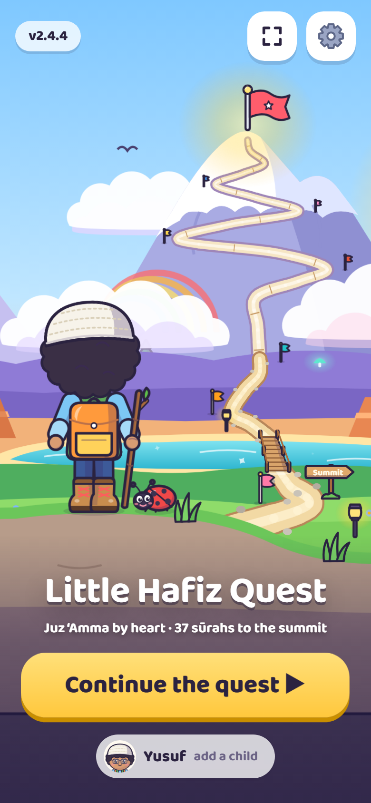
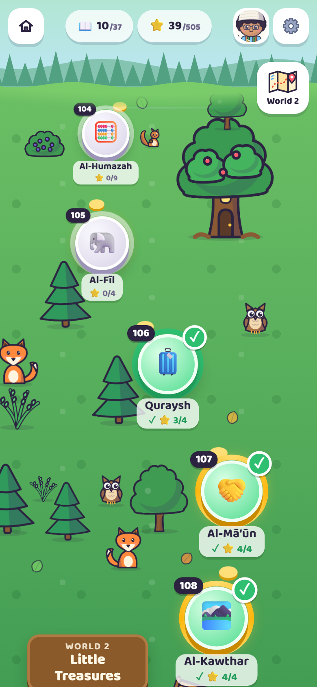
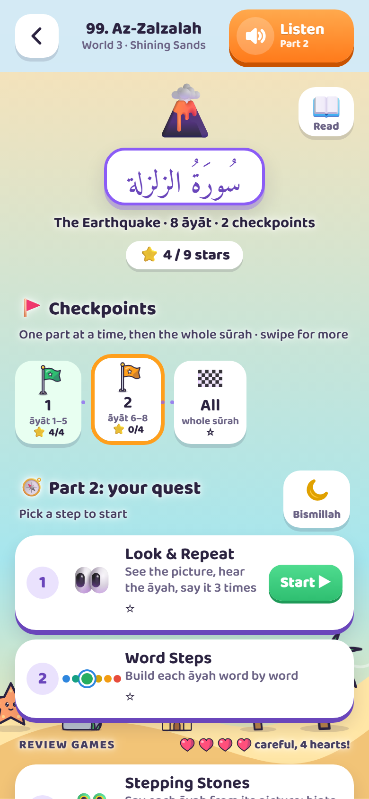
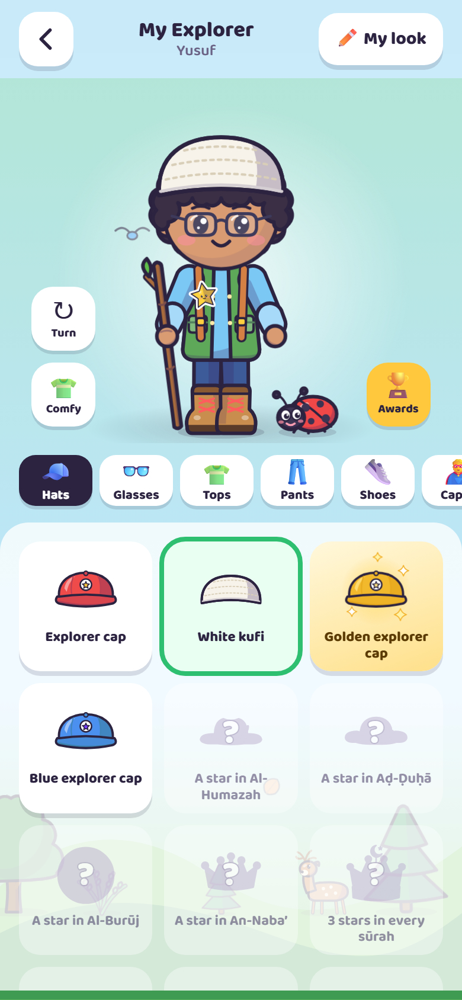
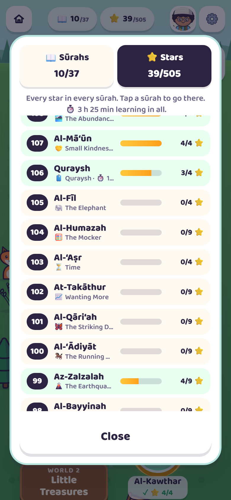
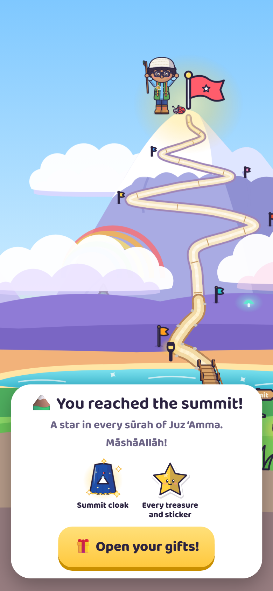

# Little Hafiz Quest

A fun, picture-and-gesture adventure that helps young children (around age 4–7) **memorize Juz ‘Amma**, sūrahs 78 to 114, by heart.

A grown-up who reads Arabic recites each āyah; the child listens, repeats and does a hand action. Every āyah has its own picture and movement, so the picture brings back the words. Step by step, the clues fade until the child recites with no help at all.

Your child's own little explorer starts in a meadow at An-Nās and climbs, sūrah by sūrah, through a forest, a beach, a desert canyon, starry hills and cloud cliffs to the top of the mountain at An-Naba’. Along the way there are over 150 things to win and wear: caps and kufis or hijabs, boots, capes, walking sticks, buddies, an astronaut suit with a toy rocket, and golden editions for the hardest-working explorers.

**Play it:** https://akramali.github.io/little-hafiz-quest/

Free, no ads, no accounts, no tracking. It works on iPhone, iPad, Android, and computers, and keeps working without internet once it's been opened.

<table>
  <tr>
    <td align="center"></td>
    <td align="center"></td>
    <td align="center"></td>
  </tr>
  <tr>
    <td align="center">Begin the quest</td>
    <td align="center">Climb the map</td>
    <td align="center">Follow the steps</td>
  </tr>
  <tr>
    <td align="center"></td>
    <td align="center"></td>
    <td align="center"></td>
  </tr>
  <tr>
    <td align="center">Collect and dress up</td>
    <td align="center">See the progress</td>
    <td align="center">Reach the summit</td>
  </tr>
</table>

> [!IMPORTANT]
> This is a free helper for parents, not an authority on the Qur'an. The text and recitation come from public sources and are **not guaranteed to be free of mistakes**. Please check each āyah against a trusted muṣḥaf or teacher before teaching it. See the [Disclaimer](#disclaimer).

---

## How to play (for the grown-up)

1. **Make an explorer.** Tap **Begin**, pick a name, boy or girl, a skin tone, a hair style and a hair color (girls can also choose a hijab and its color). Girls wear the crowns as tiaras. Each child can have their own explorer, with their own stars and treasures (tap the name on the start screen). Explorers can be removed in the Grown-up Corner, all of them if you like; Begin then makes a new one.
2. **Walk the map.** Start at 🚩 An-Nās at the bottom and climb. Tap a sūrah: the explorer pops up beside it, walks in, and the lesson opens. Each world has its own border to cross (a river, the sea, a gorge, a gate, the clouds, a frozen river), and the scenery on the horizon changes as you climb. The world list on the side jumps between worlds. You can go back to any sūrah at any time to revise.
3. **Follow the glowing step** in each sūrah:
   1. **👀 Look & Repeat.** Read the āyah. Your child repeats it three times while doing the action (pop a bubble each time), then says it with only the picture showing. After each new āyah, chain from the first āyah up to the new one. Tap the numbered dots at the top to practice any āyah in that part. The “Do it” actions can be switched off in the Grown-up Corner. Progress is saved āyah by āyah, so you can stop and carry on later.
   2. **Word Steps.** Build the āyah one word at a time, always going back to the first word. Tap any word to hear just that word. Then your child says it all while you reveal each word.
   3. **🐸 Stepping Stones.** Your child says each āyah and taps the frog to hop. Level 1 shows the picture and first word, Level 2 only the picture, and Level 3 no picture at all. **Hint** reveals a little more each tap (the picture, then one word at a time, then the whole āyah to hear). Level 3 means it's memorized.
   4. **Review games:** 🧩 Picture Puzzle and 🔮 What Comes Next.
4. **Hearts.** Once a part has been learned, the review games (and Stepping Stones) have 3 hearts, plus one more for each finished world (a star in every sūrah of it), up to 5. A wrong pick, or the grown-up tapping **Not quite**, costs a heart. Losing them all drops the explorer's newest treasure at that sūrah, puts a 💔 on it on the map, and leaves the explorer a little sad and scruffy. Finishing a review game there fixes it: the treasure flies back on and the explorer smiles again. You can switch hearts off in the Grown-up Corner.
5. **Gifts.** One star is enough to move on.
   - The first star in a sūrah wins its own treasure (they get shinier higher up the mountain); **every** star in a sūrah wins a golden edition of it.
   - The **star track** gives a prize every few stars, from 4 stars up to 900: an astronaut set with a toy rocket, new hats, a little thobe, walking sticks, buddies and color versions of the clothes. Boys win kufis and girls win hijabs. The end of each game shows how many stars are left to the next prize.
   - Crossing a checkpoint wins a small gift, and the first game of each day gives a sticker to stick on the explorer's shirt.
   - Gifts wait in a little rattling box at the top; tap it to open them one at a time.
6. **My Explorer** (the backpack): the explorer always stays in view while you pick from a row of categories. A red dot marks new things, which come first. The 👕 button beside the explorer swaps between just the comfy clothes and everything they were wearing. Tap the explorer (or just wait) and they giggle, jump, dance, wave or twirl their stick. On the map and the start screen, the explorer, animals, trees, houses and the summit flag react to a tap too.
7. **Progress.** Tap the 📖 (sūrahs done, at least one star each) or ⭐ (all stars) counters at the top of the map to see every sūrah. Tap one to go straight there: the explorer walks in and the next lesson starts.
8. **The summit.** With a star in every sūrah, the explorer climbs to the top of the mountain and cheers: every treasure and sticker is unlocked, plus the **Summit cloak**. Three stars in every sūrah win the **Hafiz crown** (a tiara for girls), and every single star wins the one-of-a-kind **Golden hoopoe**.

Longer sūrahs are split into checkpoints of a few āyāt; finish the checkpoints, then the 🏁 whole sūrah. Each sūrah also has a **tip for grown-ups**, sometimes with a toy to tap along (a bell, a drum, a clap).

Five to ten minutes a day is plenty. Stop while it's still fun.

The orange **Listen** button at the top plays the recitation of what's on screen. In the Grown-up Corner (⚙️) you can choose the reciter (Mishary Alafasy, Al-Husary's slow teaching recitation, Al-Minshawi or Abdul Basit), turn the nature sounds on or off (soft water drops, birdsong and a breeze as you play, quieter while the reciter plays), hearts, the “Do it” actions, fullscreen (hides the browser's address bar where the browser allows it; on iPhone, use Add to Home Screen instead), a dim night theme, simple meanings or transliteration, repeat or slow down the recitation, and manage explorers and stars.

## Versions

The newest version opens by default. Tap the version badge on the start screen (or Grown-up Corner → Version) to switch to the classic **v1**, which keeps the original island list. The choice is remembered on that device, and you can switch back the same way. If something goes wrong, opening https://akramali.github.io/little-hafiz-quest/?latest always brings back the newest version.

## Put it on a phone like an app

**iPhone or iPad**
1. Open the link in **Safari**.
2. Tap **Share** → **Add to Home Screen**.
3. Open the game from the new Home Screen icon from now on. On iPhone, the Home Screen app keeps its own stars, separate from Safari.
4. For full offline use, go to ⚙️ Grown-up Corner → Offline → **Save all recitations** (about 21–35 MB for the chosen reciter, once).

**Android**
1. Open the link in **Chrome**.
2. Tap **⋮** → **Add to Home screen** (or **Install app**).
3. For full offline use: ⚙️ → Offline → **Save all recitations**.

**Computer**: just open the link. Chrome and Edge also offer an "Install" button in the address bar.

> Opening the `index.html` file straight from Files, WhatsApp or email on an iPhone shows a preview that can't run games. Always share the **link**.

## Privacy

- No accounts, analytics, ads or trackers.
- The game never contacts any other website. Every file it uses is in this repository.
- Stars and settings are stored only on the device (browser cookies and storage). Nothing is uploaded.

## Browser support

Safari on iOS and iPadOS 15 or later, Chrome, Edge, Firefox and Samsung Internet, on phones, tablets and computers.

---

## For developers

No build step and no dependencies: plain HTML, CSS and JavaScript.

```
index.html                 page shell, security policy, Home Screen metadata
css/game.css               styles (light and dim themes, screens, animations)
css/art.css                animations for the drawings (explorer walk, sparkles, swaying grass…)
js/boot.js                 opens the version a family chose (runs first)
js/data.js                 all content: Arabic text, memory cues and tips, checkpoints
js/art.js                  every drawing, as SVG: explorer, outfits, gifts, stickers, worlds, splash
js/map.js                  the quest map: winding path, worlds, curved-world scrolling, walking
js/sounds.js               soft nature sounds for taps and play, made with Web Audio (no sound files)
js/game.js                 game logic: screens, explorers, gifts, hearts, recitation player
sw.js                      service worker: offline support
manifest.webmanifest       Home Screen app details
versions.json              the versions offered in the version chooser
audio/reciters.json        the reciters offered in the Grown-up Corner
audio/<reciter>/NNN.mp3    recitation, one file per sūrah (plus 001.mp3 for the Basmalah)
audio/<reciter>/timings.json  where each āyah and each word sits in those files
fonts/                     Amiri Quran and Baloo 2, with their licenses
icons/                     app icons
tools/serve.py             local preview server
tools/build_audio.py       rebuilds the recitation files and timings (see below)
tools/art-gallery.html     every drawing on one page, for checking art changes
tools/sound-board.html     every sound on one page, to hear them side by side
.github/workflows/         publishing to GitHub Pages
screenshots/               README pictures (not used by the game)
```

**Preview locally**

```
python3 tools/serve.py
```

Then open http://localhost:8000/. Use this rather than `python3 -m http.server`, because the audio player needs "Range" requests to jump to each āyah.

**Change a picture, action or meaning:** edit that āyah's line in `js/data.js`. Each āyah has `scene` (1–3 emoji), `hook`, `gesture`, `kid` (simple meaning) and `anim`. Keep scenes different within a sūrah.

**Change a tip for grown-ups:** edit the sūrah's `pattern` in `js/data.js`. An optional `toy` (for example `["🔔", "bell"]`) adds a button to tap along.

**Add or rebuild a reciter:** `python3 tools/build_audio.py --list` shows the reciters it knows; `python3 tools/build_audio.py minshawi` builds one. It needs `ffmpeg` (the script explains how to get one without installing anything system-wide). The script downloads each āyah from EveryAyah.com with Quran.com's word timings, joins them into one file per sūrah and writes `timings.json` and `audio/reciters.json`.

**Change a drawing or add a gift:** see the notes at the top of `js/art.js`, and check the result in `tools/art-gallery.html`.

**After any change:** bump `VERSION` in `sw.js` (and in `js/game.js`, which is shown in settings). Installed copies then pick up the new version on their next visit.

**Branches and deploy:** `main` is the newest version; `v1` is the classic version, kept on its own branch so it can still get fixes. The workflow in `.github/workflows/pages.yml` publishes `main` at the site root and `v1` in the `v1/` folder (GitHub Pages source: *GitHub Actions*). Pushing to either branch republishes the site within a few minutes. To add a version later, add its branch to the workflow and to `versions.json`; to retire one, remove it from both.

## Disclaimer

Little Hafiz Quest is a free tool, made only to help parents and other grown-ups teach young children. It is provided **"as is", without any warranty**.

- **No guarantee of correctness.** The Arabic text, recitation audio, āyah timings, simple meanings and transliterations come from public sources and were put together with care, but their accuracy and completeness are not guaranteed.
- **You are responsible for checking.** The grown-up using the game is responsible for making sure every āyah and recitation is correct before teaching it, by checking against a trusted muṣḥaf or a qualified teacher.
- **Not a replacement for a teacher.** The simple meanings are written for young children and are not a translation or tafsīr. The game supports, but does not replace, learning with a qualified Qur'an teacher.
- **No liability.** The author accepts no responsibility or liability for errors in the content, for anything a child learns incorrectly, or for any problem, loss or harm arising from using this game. Use it at your own risk.

See also the warranty and liability terms in [LICENSE](LICENSE).

## Credits and licenses

- **Code and drawings** (`index.html`, `css/`, `js/boot.js`, `js/game.js`, `js/map.js`, `js/art.js`, `sw.js`, `tools/`, `manifest.webmanifest`, `icons/`): MIT, see [LICENSE](LICENSE).
- **Qur'an text** in `js/data.js`: from [quran-json](https://github.com/risan/quran-json) by Risan Bagja Pradana (Uthmani text from [The Noble Qur'an Encyclopedia](https://quranenc.com)), licensed [CC BY-SA 4.0](https://creativecommons.org/licenses/by-sa/4.0/). `js/data.js` adapts it (open tanwīn marks converted to standard Unicode, memory cues added) and is shared under CC BY-SA 4.0 as well.
- **Memory cues, simple meanings and transliterations** in `js/data.js`: written for this project, CC BY-SA 4.0. The simple meanings are written for young children and are not a translation; see a full tafsīr for detail.
- **Recitation** in `audio/`: Sheikh Mishary Rashid Alafasy, Sheikh Mahmoud Khalil Al-Husary (Muallim), Sheikh Mohamed Siddiq Al-Minshawi and Sheikh Abdul Basit Abdul Samad, from [EveryAyah.com](https://everyayah.com), joined into one file per sūrah. Word timings from [Quran.com](https://quran.com). Included for free, non-commercial educational use; all rights to the recordings remain with their owners.
- **Fonts**: [Amiri Quran](https://github.com/aliftype/amiri) by Khaled Hosny and [Baloo 2](https://github.com/EkType/Baloo2) by Ek Type, both under the SIL Open Font License 1.1 (see `fonts/`).
- **Āyah pictures** are the device's own emoji, so they look slightly different on each phone. The explorer, gifts and worlds are drawn for this project (`js/art.js`).
